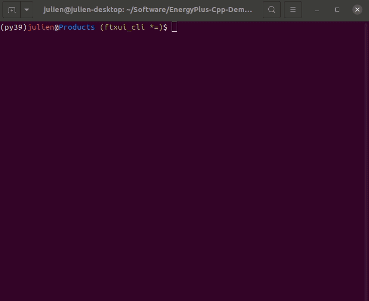

# C++ to drive EnergyPlus

[](https://github.com/jmarrec/EnergyPlus-Cpp-Demo/actions/workflows/build.yml)
[](https://github.com/jmarrec/EnergyPlus-Cpp-Demo/actions/workflows/clang-format-check.yml)
[](https://github.com/jmarrec/EnergyPlus-Cpp-Demo/actions/workflows/cppcheck.yml)



## Usage

This uses my branch: https://github.com/NREL/EnergyPlus/tree/export_energyplusapi


Make sure you have conan installed: `pip install conan` (tested with 1.53)

```shell
conan install . --output-folder=build --build=missing -c tools.cmake.cmaketoolchain:generator=Ninja -s compiler.cppstd=20 -s build_type=Release
cmake --preset conan-release -Denergyplus_DIR:PATH=/Applications/EnergyPlus-25-2-0/lib/cmake/energyplus
cmake --build --preset conan-release
./build/Products/epcli -w /path/to/weather.epw -d out 1ZoneUncontrolled.idf
```
